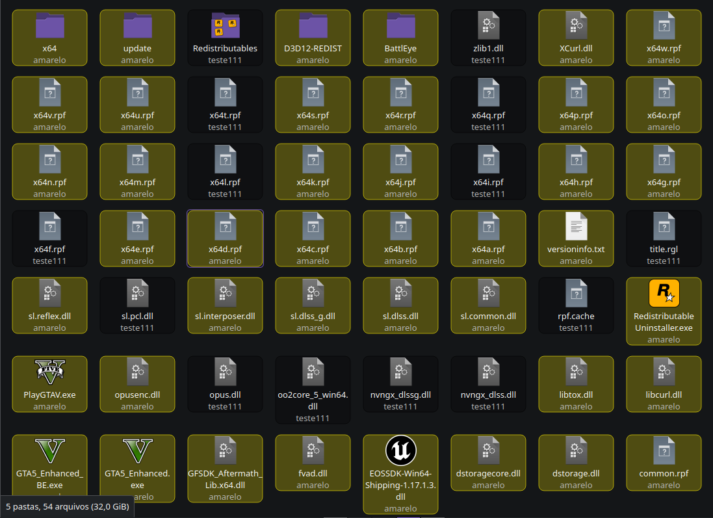
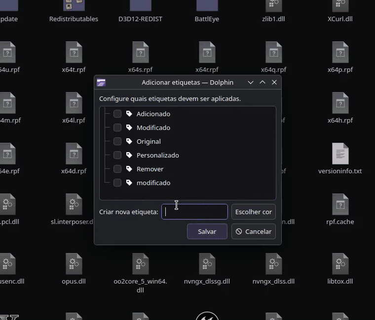
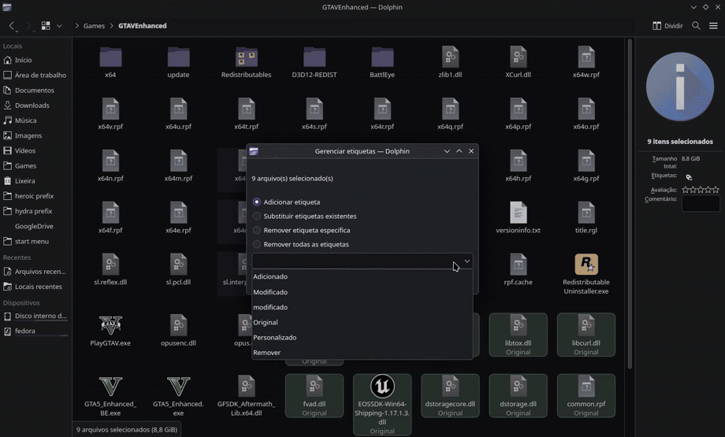
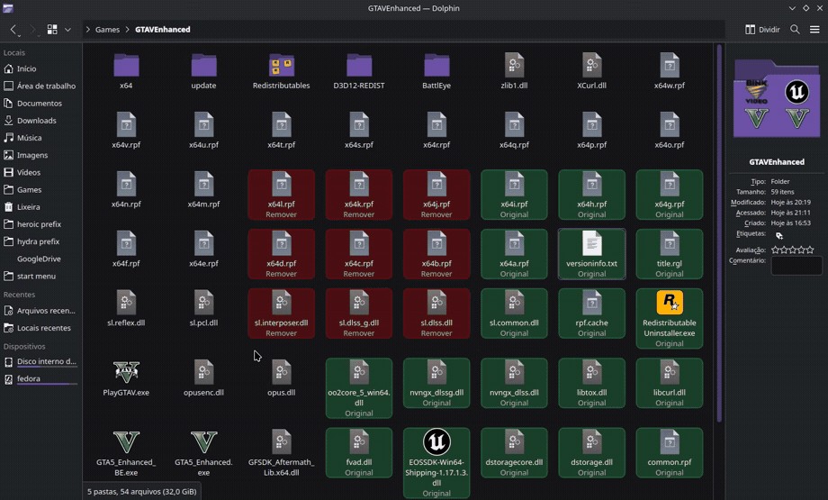

# Dolphin Color Tags

**Bring color to your files.**

An independent, open-source modification of KDE Dolphin and Baloo Widgets.

[Features](#features) · [Installation](#installation) · [Roadmap](#roadmap) · [Português](README.pt-BR.md)

*Real screenshot from the experimental build on Fedora KDE.*

## Why Dolphin Color Tags?

Originally created to distinguish original game files from modded files, this project brings visual file organization directly into Dolphin. It uses native KDE file metadata and adds colored backgrounds without a separate background service.

## Features

### Custom colors

Create a tag and choose its color with the visual Qt color picker or enter a HEX value. Colors are stored in a local configuration file.

### Bulk tag management

Select multiple files or folders and manage their tags from the context menu. Add a tag, replace existing tags, remove a specific tag or clear all tags. These operations edit metadata, not file contents.

### Visual organization

Rounded outlines and translucent backgrounds make tagged items easy to distinguish. Existing tags can be replaced in bulk.

## Compatibility

| Component | Tested environment |
| --- | --- |
| Distribution | Fedora Linux 44 |
| Desktop | KDE Plasma 6 |
| Dolphin | 26.08.3 |
| Baloo Widgets | 26.08.3 |
| Architecture | x86-64 |

## Installation

**Experimental source patches only.** A public installer and prebuilt packages are not available yet. The current patches target the exact upstream versions listed above. See [upstream.conf](upstream.conf) for pinned revisions and [patches](patches/) for the modifications. The development build was installed separately from the system Dolphin.

Do not replace your system binaries with untested builds. Test tag operations on disposable files first. Back up valuable metadata before bulk changes.

## Roadmap

- [x] Colored file and folder backgrounds
- [x] Visual color picker and HEX input
- [x] Bulk tag management
- [ ] Review metadata updates and tag persistence edge cases
- [ ] Appearance settings and live refresh
- [ ] Internationalization (current custom UI is in Portuguese)
- [ ] Installer, uninstaller and Fedora RPM
- [ ] Automated tests and wider distribution support

## Contributing

Bug reports, code review and improvements are welcome. Include your distribution, Dolphin and Baloo Widgets versions, and steps to reproduce the issue. Remove personal information from logs and screenshots.

## AI transparency

Created, directed and manually tested by Makita, with assistance from ChatGPT (OpenAI) in code generation, debugging, interface design and documentation. AI-assisted code may contain errors and benefits from human review. See [AI_DISCLOSURE.md](AI_DISCLOSURE.md).

## Licensing and credits

Built on [KDE Dolphin](https://invent.kde.org/system/dolphin) and [Baloo Widgets](https://invent.kde.org/libraries/baloo-widgets). Original copyright notices and applicable upstream licenses are preserved; see [LICENSES](LICENSES/). This independent project is not officially affiliated with KDE or OpenAI.
