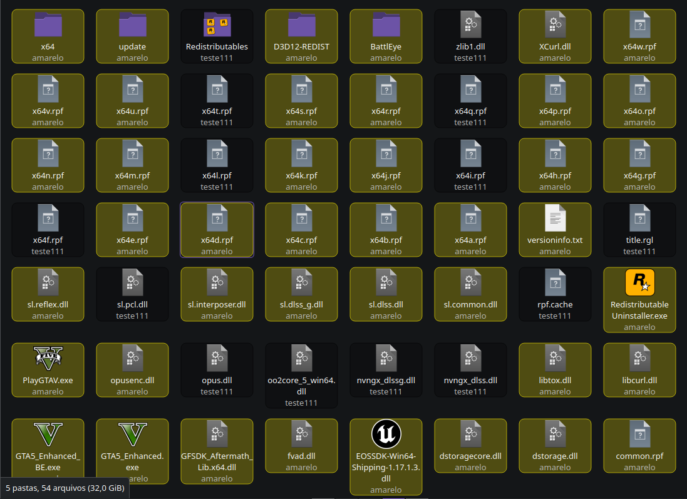
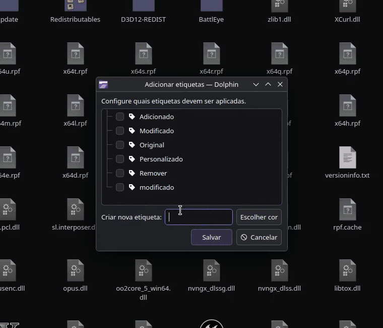
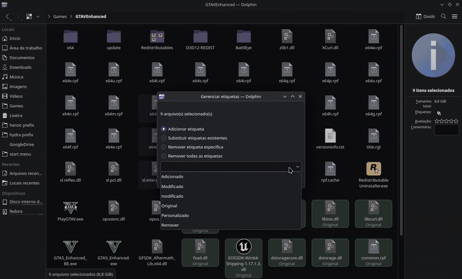
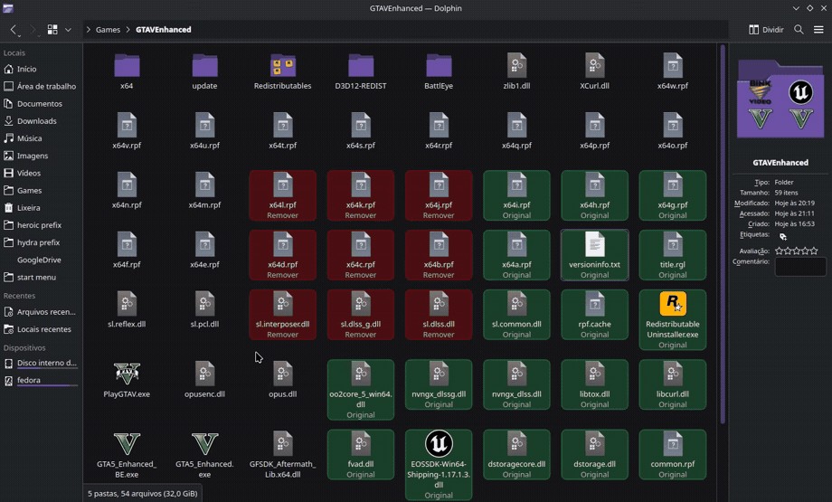

# Dolphin Color Tags

**Mais cor para seus arquivos.**

Modificação independente e de código aberto do KDE Dolphin e Baloo Widgets.

[English](README.md)

## Sobre o projeto

Criado inicialmente para distinguir arquivos originais de jogos e mods, o Dolphin Color Tags adiciona organização visual ao gerenciador de arquivos, utilizando os metadados nativos do KDE e sem um serviço adicional em segundo plano.

## Funcionalidades

### Cores personalizadas

Escolha a cor de uma etiqueta pelo seletor visual ou pelo código HEX.

### Gerenciamento em massa

Adicione, substitua ou remova etiquetas de vários arquivos pelo menu de contexto. A operação modifica metadados, não o conteúdo dos arquivos.

### Organização visual

Fundos translúcidos e contornos arredondados permitem distinguir etiquetas visualmente.

## Compatibilidade e instalação

Versão 0.3 experimental, testada no Fedora 44 x86-64, KDE Plasma 6, Dolphin 26.08.3 e Baloo Widgets 26.08.3. Ainda não há instalador público ou pacote pré-compilado. Os [patches](patches/) são destinados às revisões especificadas em [upstream.conf](upstream.conf). Teste em arquivos descartáveis e faça backup de metadados importantes antes de operações em massa.

## Próximos passos

- Revisão de persistência e atualização visual das etiquetas.
- Configurações de aparência e traduções.
- Instalador, desinstalador e pacote RPM.
- Testes automatizados e suporte a outras distribuições.

## Transparência sobre IA

Projeto criado, dirigido e testado manualmente por Makita, com assistência do ChatGPT (OpenAI) na geração de código, depuração, design e documentação. Consulte [AI_DISCLOSURE.md](AI_DISCLOSURE.md). Contribuições e revisão humana são bem-vindas.

## Licenças e créditos

Baseado no [KDE Dolphin](https://invent.kde.org/system/dolphin) e no [Baloo Widgets](https://invent.kde.org/libraries/baloo-widgets). Os avisos de copyright e licenças originais aplicáveis são preservados em [LICENSES](LICENSES/). Projeto independente, sem afiliação oficial com KDE ou OpenAI.
